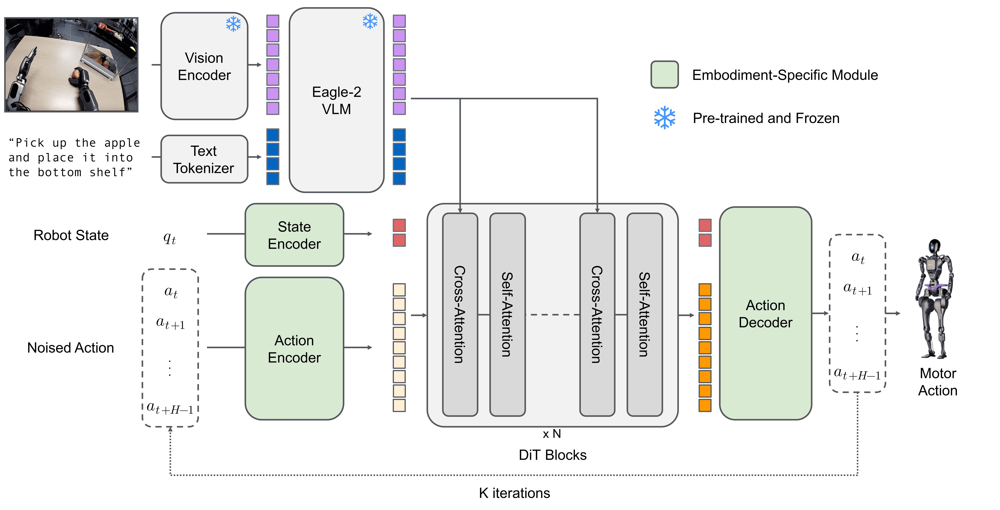
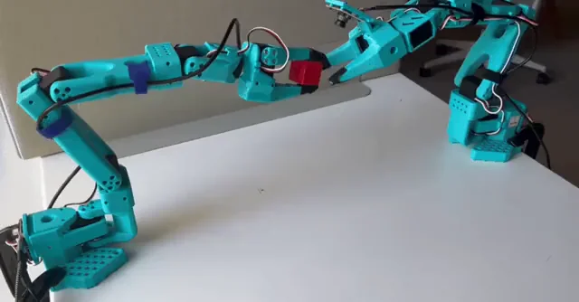

[English](README.md) | 简体中文

<p align="center">
  
</p>

> 改动清单见 [NOTICE](NOTICE)。

本项目基于 LeRobot 官方源码复制并改造，适配 **SO-ARM101 7 自由度机械臂**（7 个 STS3215 舵机）。

**与官方 SO-101（6 舵机）的核心差异：**

| 舵机 ID | 官方 SO-101 | 本仓库（SO-101 7-DOF） |
| :---: | :--- | :--- |
| 1 | shoulder_pan | shoulder_pan |
| 2 | shoulder_lift | shoulder_lift |
| 3 | elbow_flex | elbow_flex |
| 4 | wrist_flex | wrist_flex |
| 5 | wrist_roll（滚动） | **wrist_yaw**（新增舵机，左右旋转 90°） |
| 6 | gripper（夹爪） | **wrist_roll**（原 5 号滚动电机，ID 5→6，名字不变） |
| 7 | — | **gripper**（夹爪，ID 6→7） |

机械安装：在原来的 4 号（`wrist_flex`）和 5 号（`wrist_roll`）之间插入新增的 `wrist_yaw` 舵机及一个打印件，其后电机整体后移一位：原 5 号滚动电机 → 6 号位，夹爪 → 7 号位（这两个老电机的打印件未改动）。

**核心代码改动：**

1. **电机定义改为 7 个**：新增 `wrist_yaw(5)`（左右旋转）；原 `wrist_roll` 电机挪到 **ID 6**（仍是滚动、名字不变）；夹爪 `gripper(6)` → `gripper(7)`。夹爪仍用 `RANGE_0_100`（0~100 开合度），其余关节用 `DEGREES`。
   - `src/lerobot/robots/so_follower/so_follower.py`
   - `src/lerobot/teleoperators/so_leader/so_leader.py`
2. **标定不再设"整圈关节"**：原代码把 `wrist_roll` 硬编码为整圈关节（0~4095）；7-DOF 改造后腕部 yaw/roll 均有机械限位、无法整圈，标定时改为用 `record_ranges_of_motion()` 记录**所有**关节的真实运动范围。
   - `src/lerobot/robots/so_follower/so_follower.py`（`calibrate()`）
   - `src/lerobot/teleoperators/so_leader/so_leader.py`（`calibrate()`）
3. **`bi_so_follower.py` / `bi_so_leader.py`**（双臂版）：只是单臂的组合+加 `left_`/`right_` 前缀，不含电机定义，自动跟随


完整的组装与流程走查（标定 → 录制 → 训练 → 部署）见教程：

📖 **[SO-ARM101 7 自由度机械臂教程](https://wiki.juxitech.com/tutorials/robot-arms/so-arm101/lerobot-7dof/)**

**LeRobot** aims to provide models, datasets, and tools for real-world robotics in PyTorch. The goal is to lower the barrier to entry so that everyone can contribute to and benefit from shared datasets and pretrained models.

🤗 A hardware-agnostic, Python-native interface that standardizes control across diverse platforms, from low-cost arms (SO-100) to humanoids.

🤗 A standardized, scalable LeRobotDataset format (Parquet + MP4 or images) hosted on the Hugging Face Hub, enabling efficient storage, streaming and visualization of massive robotic datasets.

🤗 State-of-the-art policies that have been shown to transfer to the real-world ready for training and deployment.

🤗 Comprehensive support for the open-source ecosystem to democratize physical AI.

## Quick Start

LeRobot can be installed directly from PyPI.

```bash
pip install lerobot
lerobot-info
```

> [!IMPORTANT]
> For detailed installation guide, please see the [Installation Documentation](https://huggingface.co/docs/lerobot/installation).

## Robots & Control

<div align="center">
  
</div>

LeRobot provides a unified `Robot` class interface that decouples control logic from hardware specifics. It supports a wide range of robots and teleoperation devices.

```python
from lerobot.robots.myrobot import MyRobot

# Connect to a robot
robot = MyRobot(config=...)
robot.connect()

# Read observation and send action
obs = robot.get_observation()
action = model.select_action(obs)
robot.send_action(action)
```

**Supported Hardware:** SO100, LeKiwi, Koch, HopeJR, OMX, EarthRover, Reachy2, Gamepads, Keyboards, Phones, OpenARM, Unitree G1, reBot B601.

While these devices are natively integrated into the LeRobot codebase, the library is designed to be extensible. You can easily implement the Robot interface to utilize LeRobot's data collection, training, and visualization tools for your own custom robot.

For detailed hardware setup guides, see the [Hardware Documentation](https://huggingface.co/docs/lerobot/integrate_hardware).

## LeRobot Dataset

To solve the data fragmentation problem in robotics, we utilize the **LeRobotDataset** format.

- **Structure:** Synchronized MP4 videos (or images) for vision and Parquet files for state/action data.
- **HF Hub Integration:** Explore thousands of robotics datasets on the [Hugging Face Hub](https://huggingface.co/lerobot).
- **Tools:** Seamlessly delete episodes, split by indices/fractions, add/remove features, and merge multiple datasets.

```python
from lerobot.datasets.lerobot_dataset import LeRobotDataset

# Load a dataset from the Hub
dataset = LeRobotDataset("lerobot/aloha_mobile_cabinet")

# Access data (automatically handles video decoding)
episode_index=0
print(f"{dataset[episode_index]['action'].shape=}\n")
```

Learn more about it in the [LeRobotDataset Documentation](https://huggingface.co/docs/lerobot/lerobot-dataset-v3).

## SoTA Models

LeRobot implements state-of-the-art policies in pure PyTorch, covering Imitation Learning, Reinforcement Learning, Vision-Language-Action (VLA) models, World Models, and Reward Models, with more coming soon. It also provides you with the tools to instrument and inspect your training process.

<p align="center">
  
</p>

Training a policy is as simple as running a script configuration:

```bash
lerobot-train \
  --policy.type=act \
  --dataset.repo_id=lerobot/aloha_mobile_cabinet
```

| Category                   | Models                                                                                                                                                                                                                                                                                                                                                                                     |
| -------------------------- | ------------------------------------------------------------------------------------------------------------------------------------------------------------------------------------------------------------------------------------------------------------------------------------------------------------------------------------------------------------------------------------------ |
| **Imitation Learning**     | [ACT](./docs/source/policy_act_README.md), [Diffusion](./docs/source/policy_diffusion_README.md), [VQ-BeT](./docs/source/policy_vqbet_README.md), [Multitask DiT Policy](./docs/source/policy_multi_task_dit_README.md)                                                                                                                                                                    |
| **Reinforcement Learning** | [HIL-SERL](./docs/source/hilserl.mdx), [TDMPC](./docs/source/policy_tdmpc_README.md) & QC-FQL (coming soon)                                                                                                                                                                                                                                                                                |
| **VLAs Models**            | [Pi0](./docs/source/pi0.mdx), [Pi0Fast](./docs/source/pi0fast.mdx), [Pi0.5](./docs/source/pi05.mdx), [GR00T N1.7](./docs/source/policy_groot_README.md), [SmolVLA](./docs/source/policy_smolvla_README.md), [XVLA](./docs/source/xvla.mdx), [EO-1](./docs/source/eo1.mdx), [MolmoAct2](./docs/source/molmoact2.mdx), [WALL-OSS](./docs/source/walloss.mdx), [EVO1](./docs/source/evo1.mdx) |
| **World Models**           | [VLA-JEPA](./docs/source/vla_jepa.mdx), [LingBot-VA](./docs/source/lingbot_va.mdx), [FastWAM](./docs/source/fastwam.mdx)                                                                                                                                                                                                                                                                   |
| **Reward Models**          | [SARM](./docs/source/sarm.mdx), [TOPReward](./docs/source/topreward.mdx), [Robometer](./docs/source/robometer.mdx)                                                                                                                                                                                                                                                                         |

Similarly to the hardware, you can easily implement your own policy & leverage LeRobot's data collection, training, and visualization tools, and share your model to the HF Hub.

For detailed policy setup guides, see the [Policy Documentation](https://huggingface.co/docs/lerobot/bring_your_own_policies). For GPU/RAM requirements and expected training time per policy, see the [Compute Hardware Guide](https://huggingface.co/docs/lerobot/hardware_guide).

## Inference & Evaluation

Evaluate your policies in simulation or on real hardware using the unified evaluation script. LeRobot supports standard benchmarks like **LIBERO**, **MetaWorld** and more to come.

```bash
# Evaluate a policy on the LIBERO benchmark
lerobot-eval \
  --policy.path=lerobot/pi0_libero_finetuned \
  --env.type=libero \
  --env.task=libero_object \
  --eval.n_episodes=10
```

Learn how to implement your own simulation environment or benchmark and distribute it from the HF Hub by following the [EnvHub Documentation](https://huggingface.co/docs/lerobot/envhub).

### Third-Party Hardware

Beyond the natively supported hardware, the community maintains a growing ecosystem of plugins for other robots, teleoperators, cameras, and sensors - UFACTORY xArm, Universal Robots UR5e, Franka, AgileX Piper, Trossen WidowX, ARX5, I2RT YAM, GELLO, SpaceMouse, Meta Quest, ROS 2 bridges, tactile and depth cameras, and more.

Plugins are auto-discovered by package name: LeRobot imports any installed package prefixed with `lerobot_robot_`, `lerobot_teleoperator_`, or `lerobot_camera_`. Install one and use the `type` it registers straight from the CLI:

```bash
pip install lerobot_robot_<name> lerobot_teleoperator_<name>

lerobot-record \
  --robot.type=<robot_name> \
  --teleop.type=<teleoperator_name> \
  --dataset.repo_id=${HF_USER}/my-dataset
```

Browse the full list in the [Third-Party Robots & Teleoperators](https://huggingface.co/docs/lerobot/main/third_party_robots) and [Third-Party Cameras & Sensors](https://huggingface.co/docs/lerobot/main/third_party_sensors) documentation.

## Resources

- **[Documentation](https://huggingface.co/docs/lerobot/index):** The complete guide to tutorials & API.
- **[Chinese Tutorials: LeRobot+SO-ARM101中文教程-同济子豪兄](https://zihao-ai.feishu.cn/wiki/space/7589642043471924447)** Detailed doc for assembling, teleoperate, dataset, train, deploy. Verified by Seed Studio and 5 global hackathon players.
- **[Discord](https://discord.gg/q8Dzzpym3f):** Join the `LeRobot` server to discuss with the community.
- **[X](https://x.com/LeRobotHF):** Follow us on X to stay up-to-date with the latest developments.
- **[Robot Learning Tutorial](https://huggingface.co/spaces/lerobot/robot-learning-tutorial):** A free, hands-on course to learn robot learning using LeRobot.
- **[T-Shirt Folding Experiment](https://huggingface.co/spaces/lerobot/robot-folding):** An end-to-end demonstration of folding t-shirts with LeRobot.
- **[LeLab](https://github.com/huggingface/leLab):** A web interface for LeRobot — teleoperate, calibrate, record datasets, replay, and train your SO arm from the browser, no CLI required.

## Citation

If you use LeRobot in your project, please cite the GitHub repository to acknowledge the ongoing development and contributors:

```bibtex
@misc{cadene2024lerobot,
    author = {Cadene, Remi and Alibert, Simon and Soare, Alexander and Gallouedec, Quentin and Zouitine, Adil and Palma, Steven and Kooijmans, Pepijn and Aractingi, Michel and Shukor, Mustafa and Aubakirova, Dana and Russi, Martino and Capuano, Francesco and Pascal, Caroline and Choghari, Jade and Meftah, Khalil and Ellerbach, Maxime and Moss, Jess and Wolf, Thomas},
    title = {LeRobot: State-of-the-art Machine Learning for Real-World Robotics in Pytorch},
    howpublished = "\url{https://github.com/huggingface/lerobot}",
    year = {2024}
}
```

If you are referencing our research or the academic paper, please also cite our ICLR publication:

<details>
<summary><b>ICLR 2026 Paper</b></summary>

```bibtex
@inproceedings{cadenelerobot,
  title={LeRobot: An Open-Source Library for End-to-End Robot Learning},
  author={Cadene, Remi and Alibert, Simon and Capuano, Francesco and Aractingi, Michel and Zouitine, Adil and Kooijmans, Pepijn and Choghari, Jade and Russi, Martino and Pascal, Caroline and Palma, Steven and Shukor, Mustafa and Moss, Jess and Soare, Alexander and Aubakirova, Dana and Lhoest, Quentin and Gallou\'edec, Quentin and Wolf, Thomas},
  booktitle={The Fourteenth International Conference on Learning Representations},
  year={2026},
  url={https://arxiv.org/abs/2602.22818}
}
```

</details>

## Contribute

We welcome contributions from everyone in the community! To get started, please read our [CONTRIBUTING.md](https://github.com/huggingface/lerobot/blob/main/CONTRIBUTING.md) guide. Whether you're adding a new feature, improving documentation, or fixing a bug, your help and feedback are invaluable. We're incredibly excited about the future of open-source robotics and can't wait to work with you on what's next—thank you for your support!

<p align="center">
  
</p>

<div align="center">
<sub>Built by the <a href="https://huggingface.co/lerobot">LeRobot</a> team at <a href="https://huggingface.co">Hugging Face</a> with ❤️</sub>
</div>
