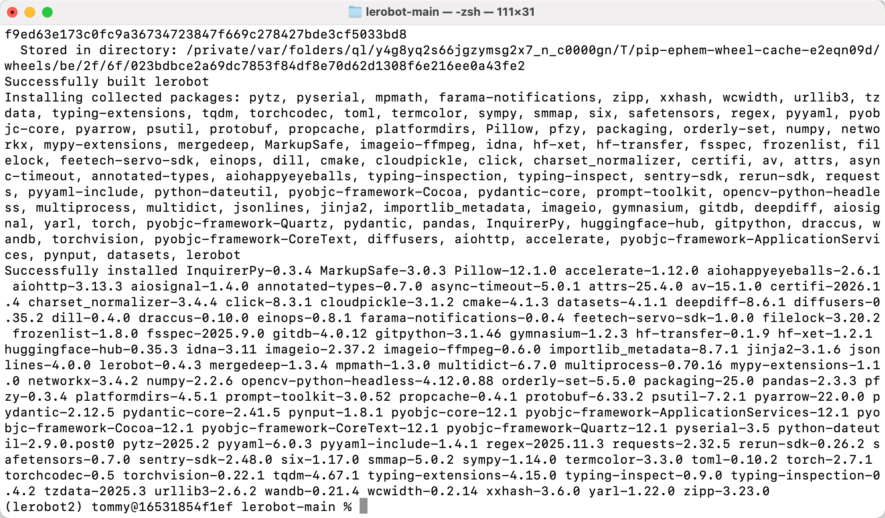

[English](../en/01-install-lerobot/mac.md) | [简体中文](../zh-hans/01-install-lerobot/mac.md) | [繁體中文](../zh-hant/01-install-lerobot/mac.md) | [Deutsch](../de/01-install-lerobot/mac.md) | [Español](../es/01-install-lerobot/mac.md) | [Français](../fr/01-install-lerobot/mac.md) | [Italiano](../it/01-install-lerobot/mac.md) | [日本語](../ja/01-install-lerobot/mac.md) | 한국어 | [Português (BR)](../pt-br/01-install-lerobot/mac.md) | [Português (PT)](../pt-pt/01-install-lerobot/mac.md)

# Mac 컴퓨터

검은색 Leader 암은 5V6A 전원 어댑터를 사용합니다.

흰색 Follower 암은 12V5A 전원 어댑터를 사용합니다.

## 권한 부여


## Miniconda 설치

https://www.anaconda.com/download

## pip 미러 변경

```Shell
pip config set global.index-url https://mirrors.aliyun.com/pypi/simple
```

## conda 미러 변경

```Shell
# 기존 .condarc 설정을 지웁니다(선택 사항, 충돌 방지용)
echo "" > ~/.condarc

# 칭화(Tsinghua) 미러 설정을 기록합니다
cat << EOF > ~/.condarc
channels:
  - defaults
show_channel_urls: true
default_channels:
  - https://mirrors.tuna.tsinghua.edu.cn/anaconda/pkgs/main
  - https://mirrors.tuna.tsinghua.edu.cn/anaconda/pkgs/r
  - https://mirrors.tuna.tsinghua.edu.cn/anaconda/pkgs/msys2
custom_channels:
  conda-forge: https://mirrors.tuna.tsinghua.edu.cn/anaconda/cloud
  msys2: https://mirrors.tuna.tsinghua.edu.cn/anaconda/cloud
  bioconda: https://mirrors.tuna.tsinghua.edu.cn/anaconda/cloud
  menpo: https://mirrors.tuna.tsinghua.edu.cn/anaconda/cloud
  pytorch: https://mirrors.tuna.tsinghua.edu.cn/anaconda/cloud
  pytorch-lts: https://mirrors.tuna.tsinghua.edu.cn/anaconda/cloud
  simpleitk: https://mirrors.tuna.tsinghua.edu.cn/anaconda/cloud
EOF

# 설정이 적용되도록 캐시를 지웁니다
conda clean -i
```

## 가상 환경 생성

```Shell
conda create -y -n lerobot python=3.12
```

## 가상 환경 활성화

```Shell
conda activate lerobot
```

## ffmpeg 설치

```Shell
conda install ffmpeg=7.1.1 -c conda-forge -y
```

설치가 성공했는지 확인합니다

```Shell
ffmpeg
```


## LeRobot 다운로드

- 공식 LeRobot 저장소를 다운로드합니다

```Shell
git clone https://github.com/huggingface/lerobot.git
```

## 코드 저장소 설치

```Shell
# cd lerobot-main
cd lerobot
pip install -e ".[feetech]"
```

<grid>
<column width-ratio="0.500000">

</column>
<column width-ratio="0.500000">

</column>
</grid>

## 설치 확인

```Shell
lerobot-info

python

import lerobot
import torch
torch.cuda.is_available()
import scservo_sdk
```


