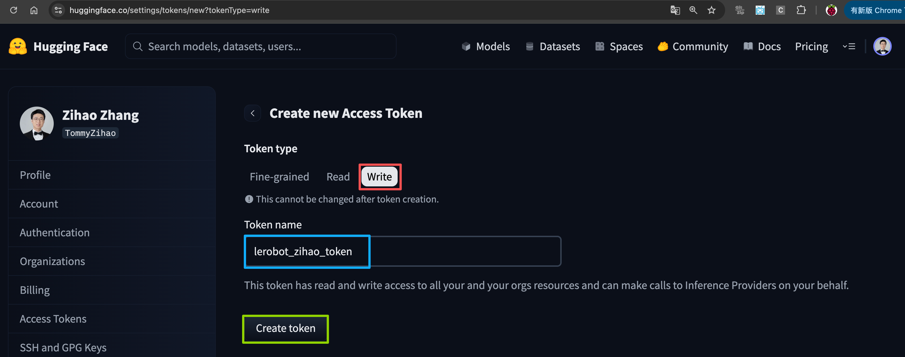
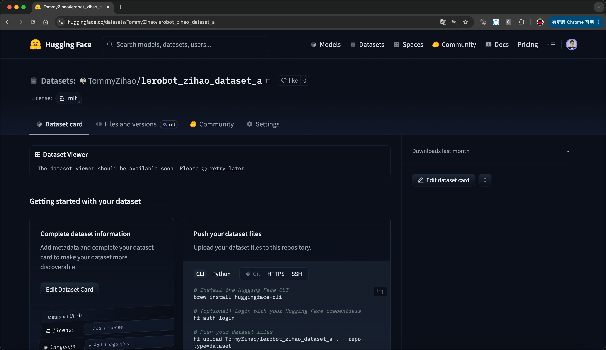

[English](../en/07-collect-dataset-real/create-huggingface-account.md) | [简体中文](../zh-hans/07-collect-dataset-real/create-huggingface-account.md) | [繁體中文](../zh-hant/07-collect-dataset-real/create-huggingface-account.md) | [Deutsch](../de/07-collect-dataset-real/create-huggingface-account.md) | [Español](../es/07-collect-dataset-real/create-huggingface-account.md) | [Français](../fr/07-collect-dataset-real/create-huggingface-account.md) | [Italiano](../it/07-collect-dataset-real/create-huggingface-account.md) | [日本語](../ja/07-collect-dataset-real/create-huggingface-account.md) | 한국어 | [Português (BR)](../pt-br/07-collect-dataset-real/create-huggingface-account.md) | [Português (PT)](../pt-pt/07-collect-dataset-real/create-huggingface-account.md)

# Hugging Face 계정 등록(선택 사항)

## 중국 내 HuggingFace 미러 설정

- Ubuntu

```Shell
sudo nano ~/.bashrc

# 파일 끝에 다음을 추가합니다
export HF_ENDPOINT=https://hf-mirror.com
```

```Shell
source ~/.bashrc
echo $HF_ENDPOINT

# 출력
# https://hf-mirror.com
```

- Mac

```Shell
sudo nano ~/.zshrc

# 파일 끝에 다음을 추가합니다
export HF_ENDPOINT=https://hf-mirror.com
```

```Shell
source ~/.zshrc

# 출력
# https://hf-mirror.com
```


## 토큰 생성

https://huggingface.co/settings/tokens


<grid>
<column width-ratio="0.606927">

</column>
<column width-ratio="0.393073">

</column>
</grid>

## 토큰 기록

예를 들어 제 것은 다음과 같습니다:

```Shell
<your-huggingface-token>
```

## 토큰 바인딩

```Shell
hf auth login

hf auth whoami
```


## 데이터셋 저장소 생성

<grid>
<column width-ratio="0.480604">

</column>
<column width-ratio="0.519396">

</column>
</grid>


