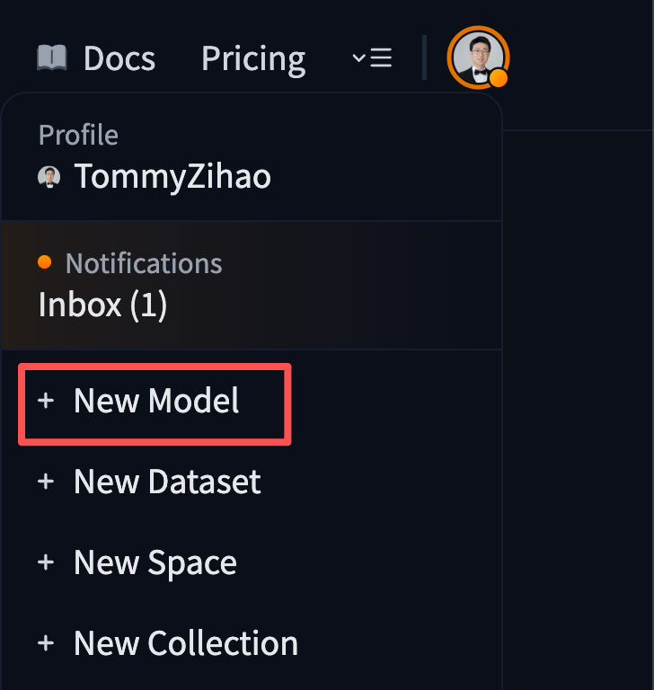

[English](../en/09-train-model/upload-model-to-huggingface.md) | [简体中文](../zh-hans/09-train-model/upload-model-to-huggingface.md) | [繁體中文](../zh-hant/09-train-model/upload-model-to-huggingface.md) | [Deutsch](../de/09-train-model/upload-model-to-huggingface.md) | [Español](../es/09-train-model/upload-model-to-huggingface.md) | [Français](../fr/09-train-model/upload-model-to-huggingface.md) | [Italiano](../it/09-train-model/upload-model-to-huggingface.md) | [日本語](../ja/09-train-model/upload-model-to-huggingface.md) | 한국어 | [Português (BR)](../pt-br/09-train-model/upload-model-to-huggingface.md) | [Português (PT)](../pt-pt/09-train-model/upload-model-to-huggingface.md)

# HuggingFace에 모델 업로드(선택)

## 모델 저장소 만들기

<grid>
<column width-ratio="0.354197">

</column>
<column width-ratio="0.645803">

</column>
</grid>

## 모델 저장소 보기

https://huggingface.co/TommyZihao/lerobot_zihao_model_a

지금은 비어 있습니다


## 모델 업로드

다음 내용으로 `upload_model.py` 파일을 만듭니다

```Python
from huggingface_hub import HfApi

api = HfApi()

repo_id = "TommyZihao/lerobot_zihao_model_shake_hands"

api.upload_folder(
    folder_path="~/output_lerobot_train/b/checkpoints/last/pretrained_model",
    repo_id=repo_id,
    repo_type="model"
)

api.create_tag(repo_id, tag="v0.1.0", repo_type="model")
```

실행합니다

```Shell
python upload_model.py
```


## 모델 저장소 보기

https://huggingface.co/TommyZihao/lerobot_zihao_model_a


이제 모델 파일이 준비되었습니다
