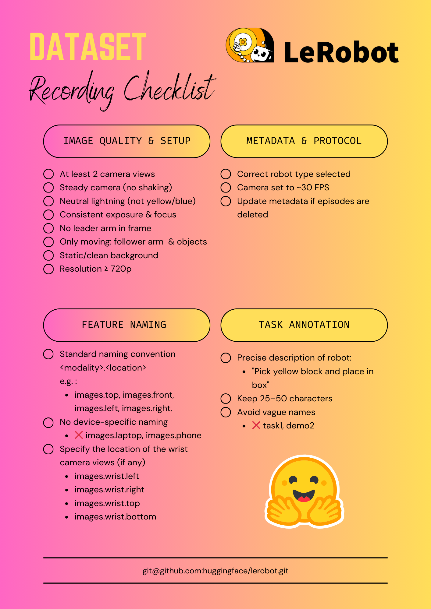

[English](../en/07-collect-dataset-real/collection-notes.md) | 简体中文 | [繁體中文](../zh-hant/07-collect-dataset-real/collection-notes.md) | [Deutsch](../de/07-collect-dataset-real/collection-notes.md) | [Español](../es/07-collect-dataset-real/collection-notes.md) | [Français](../fr/07-collect-dataset-real/collection-notes.md) | [Italiano](../it/07-collect-dataset-real/collection-notes.md) | [日本語](../ja/07-collect-dataset-real/collection-notes.md) | [한국어](../ko/07-collect-dataset-real/collection-notes.md) | [Português (BR)](../pt-br/07-collect-dataset-real/collection-notes.md) | [Português (PT)](../pt-pt/07-collect-dataset-real/collection-notes.md)

# 采集数据集注意事项

https://huggingface.co/blog/lerobot-datasets#what-makes-a-good-dataset

主动臂不应出现在画面中

