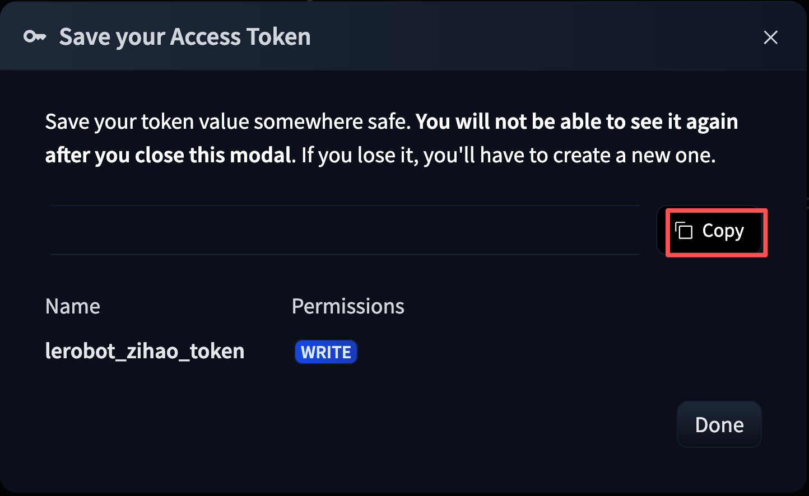
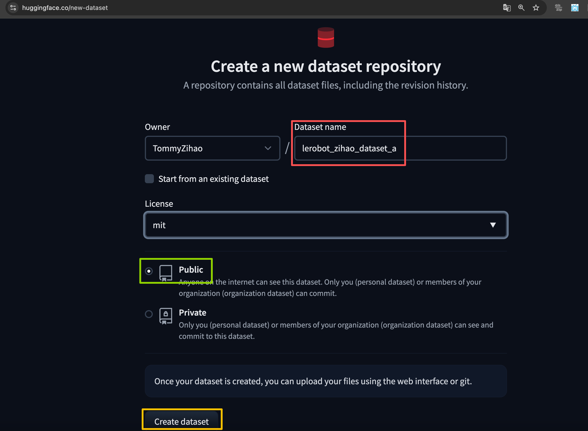

[English](../en/07-collect-dataset-real/create-huggingface-account.md) | 简体中文 | [繁體中文](../zh-hant/07-collect-dataset-real/create-huggingface-account.md) | [Deutsch](../de/07-collect-dataset-real/create-huggingface-account.md) | [Español](../es/07-collect-dataset-real/create-huggingface-account.md) | [Français](../fr/07-collect-dataset-real/create-huggingface-account.md) | [Italiano](../it/07-collect-dataset-real/create-huggingface-account.md) | [日本語](../ja/07-collect-dataset-real/create-huggingface-account.md) | [한국어](../ko/07-collect-dataset-real/create-huggingface-account.md) | [Português (BR)](../pt-br/07-collect-dataset-real/create-huggingface-account.md) | [Português (PT)](../pt-pt/07-collect-dataset-real/create-huggingface-account.md)

# 注册Hugging Face账号（可选）

## 设置HuggingFace国内镜像

- Ubuntu

```Shell
sudo nano ~/.bashrc

# 在文件末尾加入
export HF_ENDPOINT=https://hf-mirror.com
```

```Shell
source ~/.bashrc
echo $HF_ENDPOINT

# 输出
# https://hf-mirror.com
```

- Mac

```Shell
sudo nano ~/.zshrc

# 在文件末尾加入
export HF_ENDPOINT=https://hf-mirror.com
```

```Shell
source ~/.zshrc

# 输出
# https://hf-mirror.com
```


## 创建Token

https://huggingface.co/settings/tokens


<grid>
<column width-ratio="0.606927">

</column>
<column width-ratio="0.393073">

</column>
</grid>

## 记录Token

例如，我的是：

```Shell
<your-huggingface-token>
```

## 绑定Token

```Shell
hf auth login

hf auth whoami
```


## 创建Dataset Repo

<grid>
<column width-ratio="0.480604">

</column>
<column width-ratio="0.519396">

</column>
</grid>


