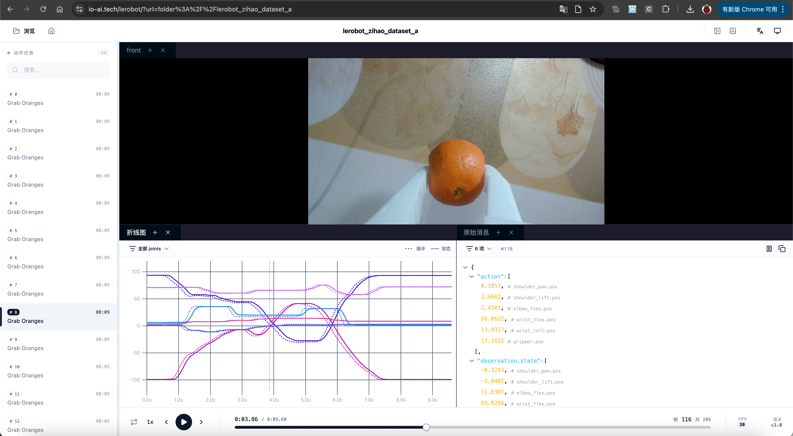

[English](../en/07-collect-dataset-real/replay-dataset.md) | 简体中文 | [繁體中文](../zh-hant/07-collect-dataset-real/replay-dataset.md) | [Deutsch](../de/07-collect-dataset-real/replay-dataset.md) | [Español](../es/07-collect-dataset-real/replay-dataset.md) | [Français](../fr/07-collect-dataset-real/replay-dataset.md) | [Italiano](../it/07-collect-dataset-real/replay-dataset.md) | [日本語](../ja/07-collect-dataset-real/replay-dataset.md) | [한국어](../ko/07-collect-dataset-real/replay-dataset.md) | [Português (BR)](../pt-br/07-collect-dataset-real/replay-dataset.md) | [Português (PT)](../pt-pt/07-collect-dataset-real/replay-dataset.md)

# 回看、回放数据集

## 可视化整个数据集

https://huggingface.co/spaces/lerobot/visualize_dataset

http://io-ai.tech/lerobot

https://open.platform.io-ai.tech

输入`TommyZihao/lerobot_zihao_dataset_a`，或者其它数据集


<grid>
<column width-ratio="0.500000">

</column>
<column width-ratio="0.500000">

</column>
</grid>

观察：指令和状态是不一致的，指令由主动臂Leader提供，状态由从动臂Follower提供

## 可视化查看指定episode

```Shell
lerobot-dataset-viz --repo-id TommyZihao/lerobot_zihao_dataset_a --episode-index=2
```


拖拽时间轴查看任意时刻的摄像头画面和舵机位置

## 回放指定episode从动臂动作

```Shell
lerobot-replay \
    --robot.type=so101_follower \
    --robot.port=/dev/tty.usbmodem5AAF2193061 \
    --robot.id=my_follower_arm \
    --dataset.repo_id=Tommymy/lerobot_my_dataset_a \
    --dataset.episode=2
```

能听到声音`Replaying episode`，然后从动臂移动，回放复现指定episode的动作

其实到这里，已经能唬住很多外行了，不是吗

<figure view-type="Preview">[附件 / Attachment: VID_20260115_140050.mp4](../../en/images/VID_20260115_140050.mp4)</figure>