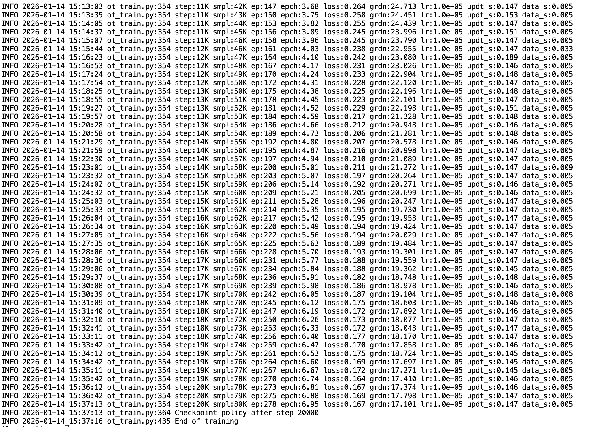

[English](../en/09-train-model/local-ubuntu-training.md) | 简体中文 | [繁體中文](../zh-hant/09-train-model/local-ubuntu-training.md) | [Deutsch](../de/09-train-model/local-ubuntu-training.md) | [Español](../es/09-train-model/local-ubuntu-training.md) | [Français](../fr/09-train-model/local-ubuntu-training.md) | [Italiano](../it/09-train-model/local-ubuntu-training.md) | [日本語](../ja/09-train-model/local-ubuntu-training.md) | [한국어](../ko/09-train-model/local-ubuntu-training.md) | [Português (BR)](../pt-br/09-train-model/local-ubuntu-training.md) | [Português (PT)](../pt-pt/09-train-model/local-ubuntu-training.md)

# 本地Ubuntu训练

https://github.com/huggingface/lerobot/blob/main/src/lerobot/scripts/lerobot_train.py

https://github.com/huggingface/lerobot/blob/main/src/lerobot/configs/train.py

- 注意

`\`前面只能有一个空格，后面不能有空格

`--dataset.split`默认为`train`，也就是用全量数据作为训练集

数据集在本地，`--dataset.streaming`必须为`false`，因为数据集已经在本地，无需流式读取

```Shell
lerobot-train \
  --dataset.repo_id=Tommymy/lerobot_my_dataset_a \
  --dataset.root=/Users/tommy/.cache/huggingface/lerobot/Tommymy/lerobot_my_dataset_a \
  --dataset.revision=v0.4.0 \
  --dataset.streaming=false \
  --policy.type=act \
  --output_dir=output_lerobot_train/a \
  --job_name=orange_job \
  --policy.device=cuda \
  --wandb.enable=true \
  --wandb.project=Lerobot_my_Project \
  --policy.push_to_hub=false \
  --steps=300000 \
  --batch_size=8
  
lerobot-train --dataset.repo_id=Tommymy/lerobot_my_dataset_a --dataset.root=/Users/tommy/.cache/huggingface/lerobot/Tommymy/lerobot_my_dataset_a --dataset.revision=v0.4.0 --dataset.streaming=false --policy.type=act --output_dir=output_lerobot_train/a --job_name=orange_job --policy.device=cuda --wandb.enable=true --wandb.project=Lerobot_my_Project --policy.push_to_hub=false --steps=300000 --batch_size=8
```

<grid>
<column width-ratio="0.357753">

</column>
<column width-ratio="0.642247">

</column>
</grid>

