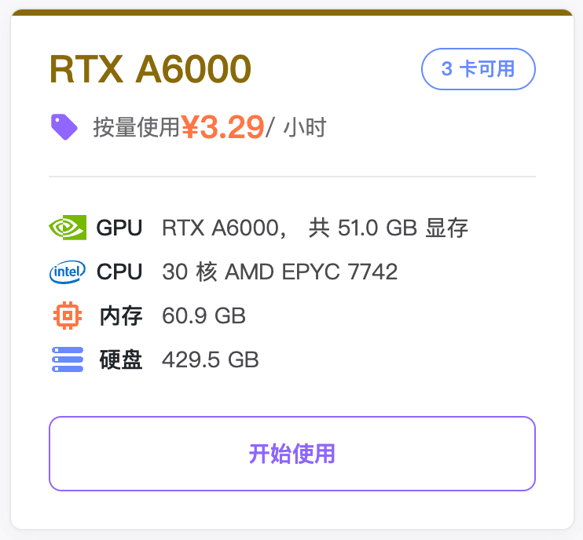
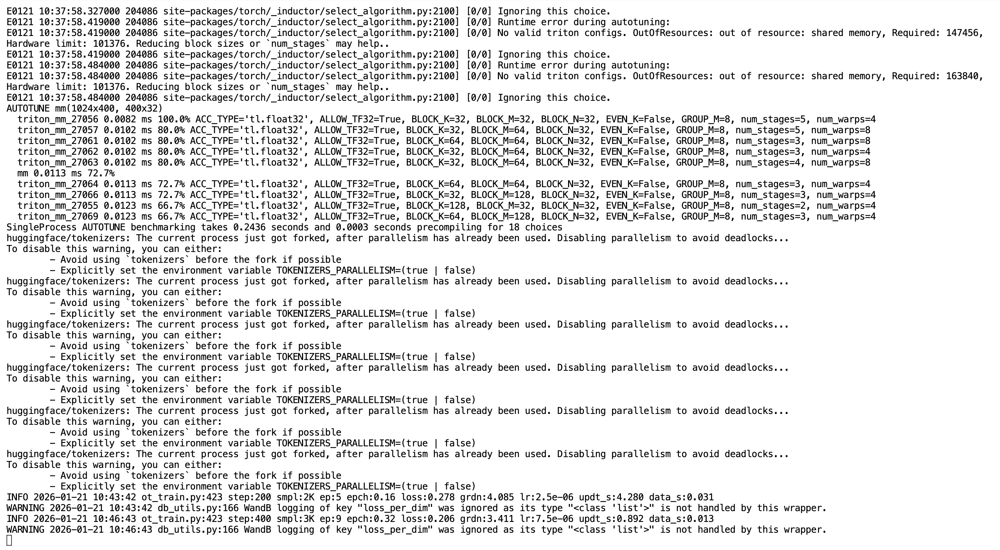

[English](../en/09-train-model/train-pi05.md) | 简体中文 | [繁體中文](../zh-hant/09-train-model/train-pi05.md) | [Deutsch](../de/09-train-model/train-pi05.md) | [Español](../es/09-train-model/train-pi05.md) | [Français](../fr/09-train-model/train-pi05.md) | [Italiano](../it/09-train-model/train-pi05.md) | [日本語](../ja/09-train-model/train-pi05.md) | [한국어](../ko/09-train-model/train-pi05.md) | [Português (BR)](../pt-br/09-train-model/train-pi05.md) | [Português (PT)](../pt-pt/09-train-model/train-pi05.md)

# 训练命令行-pi0.5

## 参考文档

https://github.com/huggingface/lerobot/blob/46e19ae579f80ce66211afafd1c3c649c569131f/docs/source/pi0.mdx

https://www.pi.website/blog/pi05

## 推荐云GPU实例



## 安装环境

```Shell
cd lerobot
pip install -e ".[pi0]"
```

## 命令行

- 删除之前训练中断的output下的文件

```Shell
sudo rm -rf output_lerobot_train/shake/pi05_A
```

- 训练

```Shell
lerobot-train \
    --dataset.repo_id=Tommymy/lerobot_my_dataset_shake_hands \
    --dataset.root=~/lerobot_my_dataset_shake_hands \
    --dataset.revision=v0.1.0 \
    --policy.type=pi05 \
    --output_dir=~/output_lerobot_train/shake/pi05_A \
    --job_name=shake_pi05_A \
    --policy.pretrained_path=lerobot/pi05_base \
    --policy.compile_model=true \
    --policy.gradient_checkpointing=true \
    --policy.dtype=bfloat16 \
    --policy.freeze_vision_encoder=false \
    --policy.train_expert_only=false \
    --steps=50000 \
    --policy.device=cuda \
    --policy.push_to_hub=false \
    --wandb.enable=true \
    --wandb.project=Lerobot_my_Project \
    --batch_size=8
```

<grid>
<column width-ratio="0.468128">
![图片展示的是在命令行中训练物理智能体（PI）的输出信息。画面中显示了模型加载、参数重映射、optimizer和scheduler创建等过程，如“Loading model from: lerobot/pi05_base”等。还出现了“Warning: Could not remap state dicts: \[‘loading’\] in state_dict for PolicyPolicy”等警告信息。此外，还呈现了训练相关数据，如“num_total_frames: 180K”等。该图片与文档中训练命令行操作内容相关，直观呈现了训练过程中的关键信息。](../../en/images/fix-03.png)
</column>
<column width-ratio="0.531872">

</column>
</grid>

命令行运行20分钟后，训练才会正式开始

模型压缩包5个G左右，解压后7个G