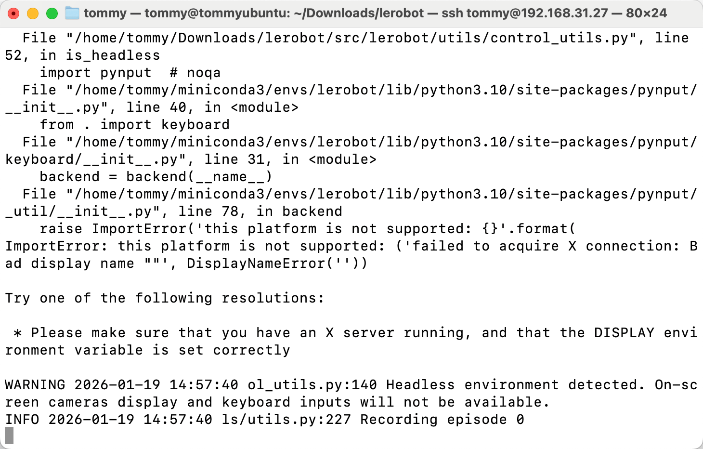
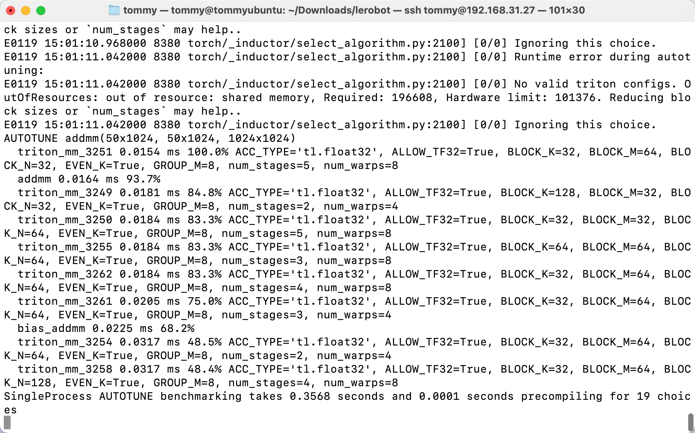
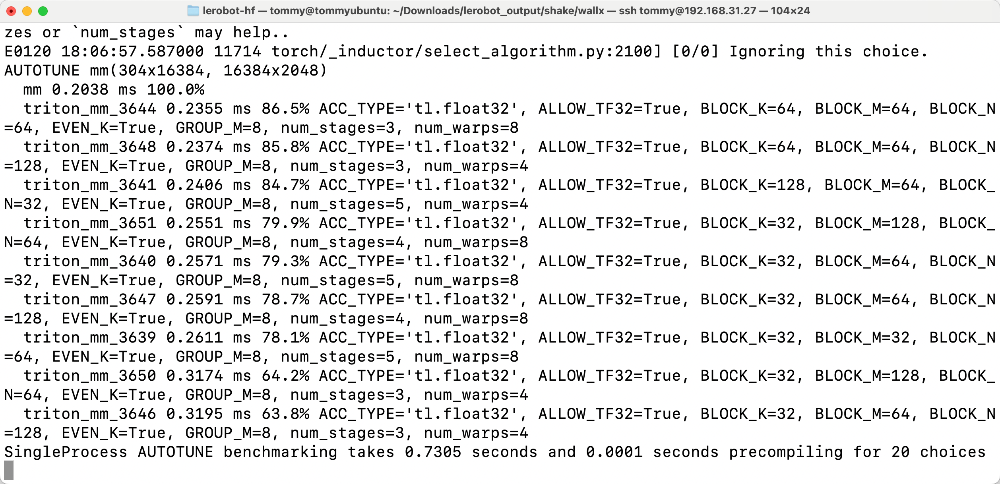
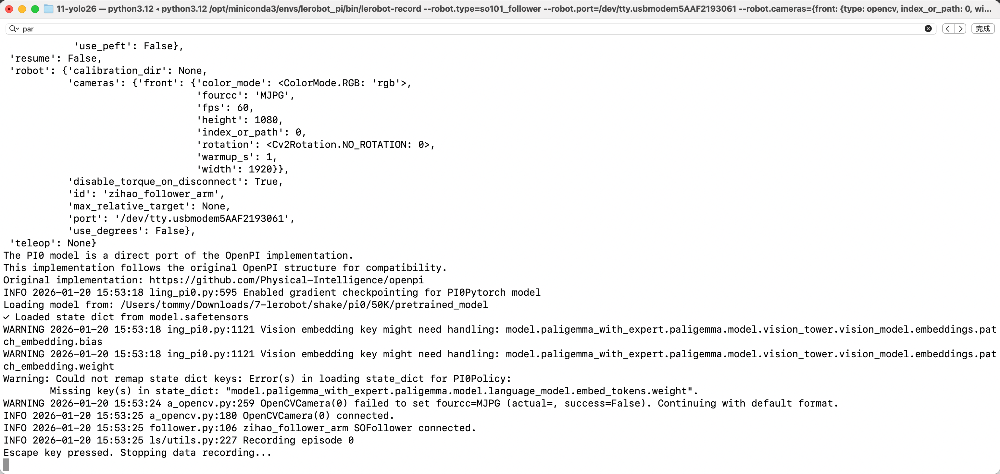

[English](../en/10-inference/infer-pi0.md) | 简体中文 | [繁體中文](../zh-hant/10-inference/infer-pi0.md) | [Deutsch](../de/10-inference/infer-pi0.md) | [Español](../es/10-inference/infer-pi0.md) | [Français](../fr/10-inference/infer-pi0.md) | [Italiano](../it/10-inference/infer-pi0.md) | [日本語](../ja/10-inference/infer-pi0.md) | [한국어](../ko/10-inference/infer-pi0.md) | [Português (BR)](../pt-br/10-inference/infer-pi0.md) | [Português (PT)](../pt-pt/10-inference/infer-pi0.md)

# 推理命令行-pi0

## Ubuntu

- 删除原有的eval开头的数据集（如有）

```Shell
sudo chmod 666 /dev/ttyACM*
sudo rm -rf /home/tommy/.cache/huggingface/lerobot/Tommymy/eval_lerobot_my_dataset_shake_hands
export TOKENIZERS_PARALLELISM=false
```

- 推理命令行

```Shell
lerobot-record  \
  --robot.type=so101_follower \
  --robot.port=/dev/ttyACM0 \
  --robot.cameras="{ front: {type: opencv, index_or_path: 0, width: 640, height: 480, fps: 60, fourcc: "MJPG"}}" \
  --robot.id=my_follower_arm \
  --display_data=false \
  --dataset.repo_id=Tommymy/eval_lerobot_my_dataset_shake_hands \
  --dataset.single_task="Shake Hands" \
  --dataset.episode_time_s=1000 \
  --dataset.push_to_hub=false \
  --policy.path=/home/tommy/Downloads/lerobot_output/shake/pi0/50K/pretrained_model
```

<grid>
<column width-ratio="0.494604">

</column>
<column width-ratio="0.505396">

</column>
</grid>



> **视频待补**：原文此处嵌有 `VID_20260120_182109.mp4`（原始 310MB）。飞书侧该文件未提供可下载的视频流，只有元数据，因此未能抓取。需查看请到[原文档](https://juxitech.feishu.cn/wiki/NOWXw9NOJiDTs2kRr7RcdIrKnvg)。


## Mac

- 删除原有的eval开头的数据集（如有）

```Shell
sudo rm -rf /Users/tommy/.cache/huggingface/lerobot/Tommymy/eval_lerobot_my_dataset_shake_hands
```

- 推理命令行

```Shell
lerobot-record  \
  --robot.type=so101_follower \
  --robot.port=/dev/tty.usbmodem5AAF2193061 \
  --robot.cameras="{front: {type: opencv, index_or_path: 0, width: 1920, height: 1080, fps: 60, fourcc: "MJPG"}}" \
  --robot.id=my_follower_arm \
  --policy.freeze_vision_encoder=false \
  --policy.dtype=bfloat16 \
  --policy.compile_model=true \
  --display_data=false \
  --dataset.repo_id=Tommymy/eval_lerobot_my_dataset_shake_hands \
  --dataset.single_task="Shake Hands" \
  --dataset.episode_time_s=1000 \
  --dataset.push_to_hub=false \
  --policy.device=cpu \
  --policy.path=/Users/tommy/Downloads/7-lerobot/shake/pi0/50K/pretrained_model
```

<grid>
<column width-ratio="0.465817">

</column>
<column width-ratio="0.534183">

</column>
</grid>

## 用Mac推理，机械臂一顿一顿的原因

- 数据集太小了
- 显卡显存不够，需要上50系显卡