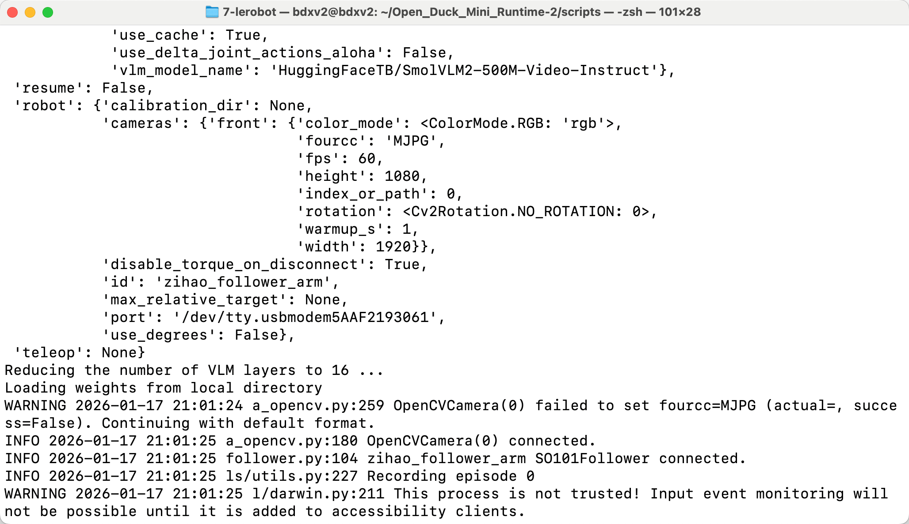

[English](../en/10-inference/infer-smolvla.md) | 简体中文 | [繁體中文](../zh-hant/10-inference/infer-smolvla.md) | [Deutsch](../de/10-inference/infer-smolvla.md) | [Español](../es/10-inference/infer-smolvla.md) | [Français](../fr/10-inference/infer-smolvla.md) | [Italiano](../it/10-inference/infer-smolvla.md) | [日本語](../ja/10-inference/infer-smolvla.md) | [한국어](../ko/10-inference/infer-smolvla.md) | [Português (BR)](../pt-br/10-inference/infer-smolvla.md) | [Português (PT)](../pt-pt/10-inference/infer-smolvla.md)

# 推理命令行-smolvla

## Ubuntu

- 删除原有的eval开头的数据集（如有）

```Shell
sudo chmod 666 /dev/ttyACM*
sudo rm -rf /home/tommy/.cache/huggingface/lerobot/Tommymy/eval_lerobot_my_dataset_shake_hands
```

- 推理命令行

```Shell
lerobot-record  \
  --robot.type=so101_follower \
  --robot.port=/dev/ttyACM0 \
  --robot.cameras="{ front: {type: opencv, index_or_path: 0, width: 640, height: 480, fps: 60, fourcc: "MJPG"}}" \
  --robot.id=my_follower_arm \
  --display_data=false \
  --dataset.repo_id=Tommymy/eval_lerobot_my_dataset_shake_hands \
  --dataset.single_task="Shake Hands" \
  --dataset.episode_time_s=1000 \
  --policy.path=/home/tommy/Downloads/lerobot_output/shake/smolvla/40K/pretrained_model
```

## Mac

- 删除原有的eval开头的数据集（如有）

```Shell
sudo rm -rf /Users/tommy/.cache/huggingface/lerobot/Tommymy/eval_lerobot_my_dataset_shake_hands
```

- 推理命令行

```Shell
lerobot-record  \
  --dataset.repo_id=Tommymy/eval_lerobot_my_dataset_shake_hands \
  --dataset.single_task="Shake Hands" \
  --policy.path=/Users/tommy/Downloads/7-lerobot/shake/smolvla/40K/pretrained_model \
  --dataset.push_to_hub=false \
  --robot.type=so101_follower \
  --robot.id=my_follower_arm \
  --robot.port=/dev/tty.usbmodem5AAF2193061 \
  --robot.cameras="{front: {type: opencv, index_or_path: 0, width: 1920, height: 1080, fps: 60, fourcc: "MJPG"}}" \
  --display_data=false \
  --dataset.episode_time_s=2000
```

<grid>
<column width-ratio="0.425772">

</column>
<column width-ratio="0.574228">

</column>
</grid>

## 效果

<grid><column width-ratio="0.500000"><figure view-type="Preview">[附件 / Attachment: wx_camera_1768642205336.mp4](../../en/images/wx_camera_1768642205336.mp4)</figure></column><column width-ratio="0.500000"><figure view-type="Preview">[附件 / Attachment: wx_camera_1768574631300.mp4](../../en/images/wx_camera_1768574631300.mp4)</figure></column></grid>