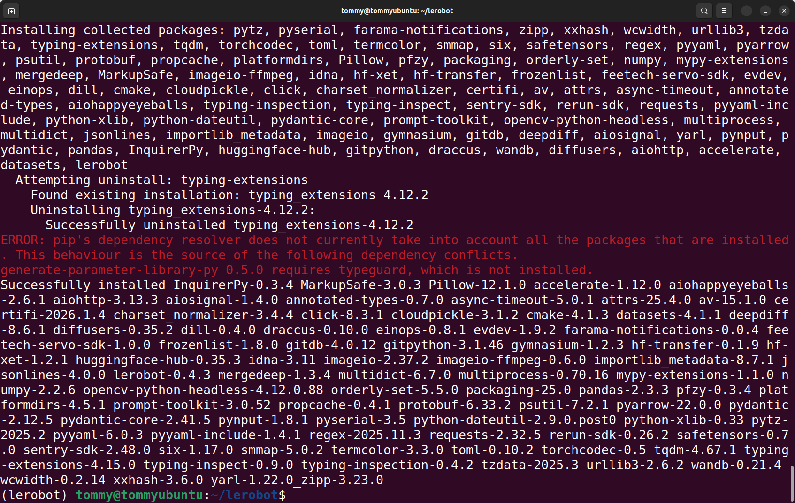

[English](../en/01-install-lerobot/ubuntu.md) | [简体中文](../zh-hans/01-install-lerobot/ubuntu.md) | 繁體中文 | [Deutsch](../de/01-install-lerobot/ubuntu.md) | [Español](../es/01-install-lerobot/ubuntu.md) | [Français](../fr/01-install-lerobot/ubuntu.md) | [Italiano](../it/01-install-lerobot/ubuntu.md) | [日本語](../ja/01-install-lerobot/ubuntu.md) | [한국어](../ko/01-install-lerobot/ubuntu.md) | [Português (BR)](../pt-br/01-install-lerobot/ubuntu.md) | [Português (PT)](../pt-pt/01-install-lerobot/ubuntu.md)

# Ubuntu電腦

黑色主動臂使用 5V6A 電源供應器

白色從動臂使用 12V5A 電源供應器

## 安裝Miniconda

https://www.anaconda.com/download

## pip換源

```Shell
pip config set global.index-url https://mirrors.aliyun.com/pypi/simple
```

## conda換源

```Shell
# 清空原有 .condarc 配置（可选，避免冲突）
echo "" > ~/.condarc

# 写入清华源配置
cat << EOF > ~/.condarc
channels:
  - defaults
show_channel_urls: true
default_channels:
  - https://mirrors.tuna.tsinghua.edu.cn/anaconda/pkgs/main
  - https://mirrors.tuna.tsinghua.edu.cn/anaconda/pkgs/r
  - https://mirrors.tuna.tsinghua.edu.cn/anaconda/pkgs/msys2
custom_channels:
  conda-forge: https://mirrors.tuna.tsinghua.edu.cn/anaconda/cloud
  msys2: https://mirrors.tuna.tsinghua.edu.cn/anaconda/cloud
  bioconda: https://mirrors.tuna.tsinghua.edu.cn/anaconda/cloud
  menpo: https://mirrors.tuna.tsinghua.edu.cn/anaconda/cloud
  pytorch: https://mirrors.tuna.tsinghua.edu.cn/anaconda/cloud
  pytorch-lts: https://mirrors.tuna.tsinghua.edu.cn/anaconda/cloud
  simpleitk: https://mirrors.tuna.tsinghua.edu.cn/anaconda/cloud
EOF

# 清除缓存使配置生效
conda clean -i
```

## 建立虛擬環境

```Shell
conda create -y -n lerobot python=3.12 -y
```

## 進入虛擬環境

```Shell
conda activate lerobot
```

## 安裝ffmpeg

```Shell
conda install ffmpeg=7.1.1 -c conda-forge -y
```

驗證安裝成功

```Shell
ffmpeg
```

<grid>
<column width-ratio="0.568354">

</column>
<column width-ratio="0.431646">

</column>
</grid>

## 下載LeRobot官方程式庫

```Shell
git clone https://github.com/huggingface/lerobot.git
```

## 安裝程式碼儲存庫

```Shell
#cd lerobot-main
cd lerobot

pip install -e ".[feetech]"
```

<grid>
<column width-ratio="0.562345">
![該圖片展示了在Ubuntu系統終端機中，進入lerobot目錄後執行`pip install -e.\[feetech\]`命令的過程，屬於LeRobot官方程式碼儲存庫安裝環節的操作日誌。圖中清楚顯示了命令執行的各個步驟，包括從指定的華為雲倉庫取得安裝套件、安裝相依套件、下載相關資料集套件（如diffusers、huggingface-hub、accelerate等），其中多個安裝套件標註了具體的下載進度、大小和速度，最終提示相依性已滿足安裝要求，完成了程式碼儲存庫的安裝相關操作。](../../en/images/fix-02.png)
</column>
<column width-ratio="0.437655">

</column>
</grid>

## 驗證安裝成功

```Shell
lerobot-info

python

import lerobot
lerobot.__version__

import torch
torch.cuda.is_available()
import scservo_sdk
```

## 在4090主機上執行的結果


## 在輝達DGX Spark上執行的結果


