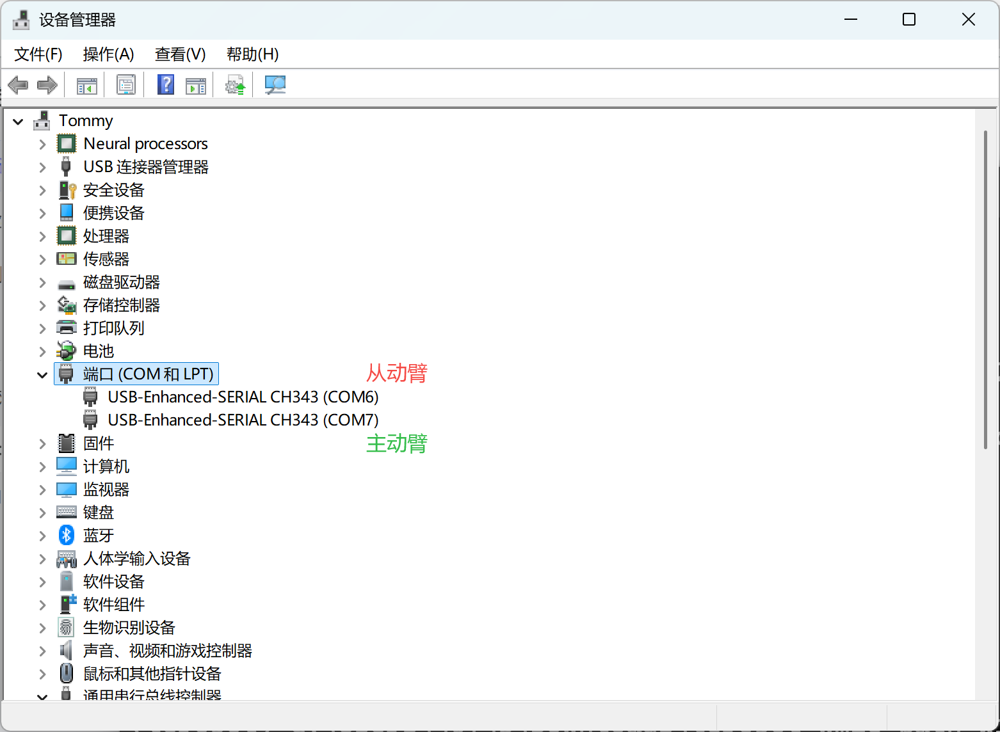

[English](../en/03-find-serial-port/windows.md) | [简体中文](../zh-hans/03-find-serial-port/windows.md) | 繁體中文 | [Deutsch](../de/03-find-serial-port/windows.md) | [Español](../es/03-find-serial-port/windows.md) | [Français](../fr/03-find-serial-port/windows.md) | [Italiano](../it/03-find-serial-port/windows.md) | [日本語](../ja/03-find-serial-port/windows.md) | [한국어](../ko/03-find-serial-port/windows.md) | [Português (BR)](../pt-br/03-find-serial-port/windows.md) | [Português (PT)](../pt-pt/03-find-serial-port/windows.md)

# Windows電腦

開啟`裝置管理員`，先插上`從動臂`，再插上`主動臂`，檢視對應的COM埠編號

## 記錄我的連接埠號

從動臂：

COM6

主動臂：

COM7
