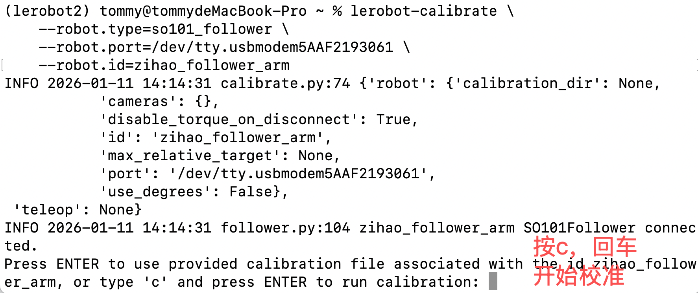
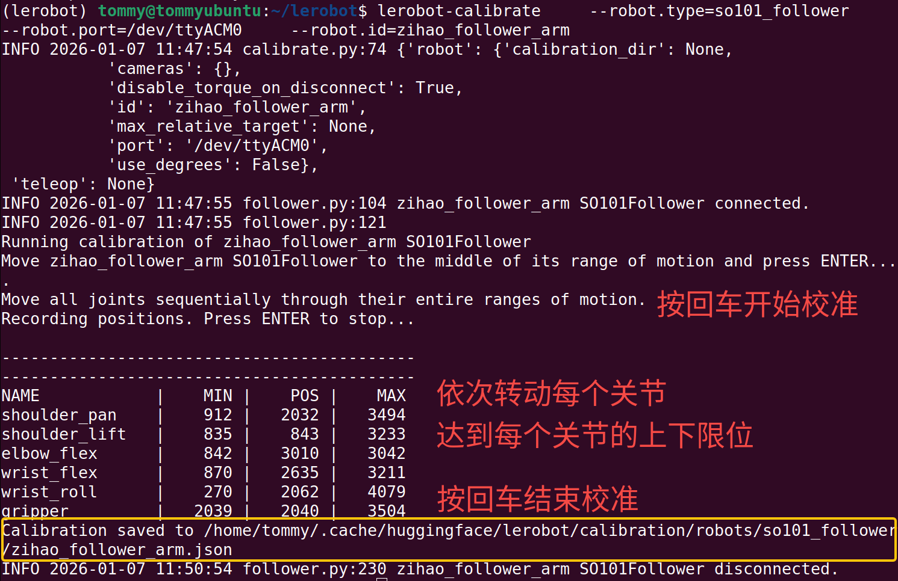
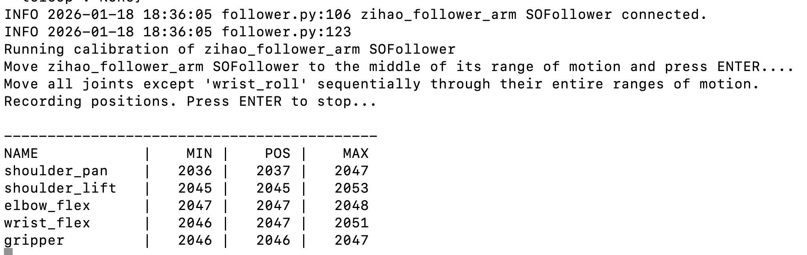

[English](../en/04-calibrate-arm/mac.md) | [简体中文](../zh-hans/04-calibrate-arm/mac.md) | 繁體中文 | [Deutsch](../de/04-calibrate-arm/mac.md) | [Español](../es/04-calibrate-arm/mac.md) | [Français](../fr/04-calibrate-arm/mac.md) | [Italiano](../it/04-calibrate-arm/mac.md) | [日本語](../ja/04-calibrate-arm/mac.md) | [한국어](../ko/04-calibrate-arm/mac.md) | [Português (BR)](../pt-br/04-calibrate-arm/mac.md) | [Português (PT)](../pt-pt/04-calibrate-arm/mac.md)

# Mac電腦

## 回顧連接埠號

從動臂：

/dev/tty.usbmodem5AAF2193061

/dev/tty.wchusbserial5AAF2193061

主動臂：

/dev/tty.usbmodem5AAF2194741

/dev/tty.wchusbserial5AAF2194741

## 校正從動臂Follower

```Shell
lerobot-calibrate \
    --robot.type=so101_follower \
    --robot.port=/dev/tty.usbmodem5AAF2193061 \
    --robot.id=zihao_follower_arm
```





## 校正主動臂Leader

```Shell
lerobot-calibrate \
    --teleop.type=so101_leader \
    --teleop.port=/dev/tty.usbmodem5AAF2194741 \
    --teleop.id=zihao_leader_arm
```


## 檢視校正設定檔

```Shell
sudo nano /Users/tommy/.cache/huggingface/lerobot/calibration/teleoperators/so101_leader/zihao_leader_arm.json
```


## 常見Bug

- 找不到其中的一個或者幾個伺服馬達




## 注意事項

### ①有一個臂達到限位後不動了

需要重新校正

<figure view-type="Preview">[附件 / Attachment: wx_camera_1768098182808.mp4](../../en/images/wx_camera_1768098182808.mp4)</figure>

### ②找不到伺服馬達


伺服馬達電源沒插
