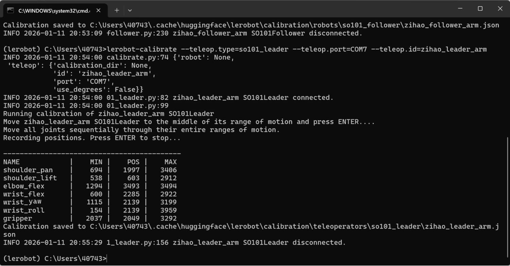

[English](../en/04-calibrate-arm/windows.md) | [简体中文](../zh-hans/04-calibrate-arm/windows.md) | 繁體中文 | [Deutsch](../de/04-calibrate-arm/windows.md) | [Español](../es/04-calibrate-arm/windows.md) | [Français](../fr/04-calibrate-arm/windows.md) | [Italiano](../it/04-calibrate-arm/windows.md) | [日本語](../ja/04-calibrate-arm/windows.md) | [한국어](../ko/04-calibrate-arm/windows.md) | [Português (BR)](../pt-br/04-calibrate-arm/windows.md) | [Português (PT)](../pt-pt/04-calibrate-arm/windows.md)

# Windows電腦


<callout emoji="🚫">
需要同時接上主動臂和從動臂
</callout>

## 校正從動臂Follower

```Shell
lerobot-calibrate --robot.type=so101_follower --robot.port=COM6 --robot.id=my_follower_arm
```


## 校正主動臂Leader

```Shell
lerobot-calibrate --teleop.type=so101_leader --teleop.port=COM7 --teleop.id=my_leader_arm
```



## 檔案匯出位置

C:\Users\40743\.cache\huggingface\lerobot\calibration\robots\so101_follower\my_follower_arm.json

C:\Users\40743\.cache\huggingface\lerobot\calibration\teleoperators\so101_leader\my_leader_arm.json


## 更換機械手臂校正

lerobot-calibrate --robot.type=so101_follower --robot.port=COM4 --robot.id=my_follower_arm


## 注意事項

### ①有一個臂達到限位後不動了

需要重新校正

<figure view-type="Preview">[附件 / Attachment: wx_camera_1768098182808.mp4](../../en/images/wx_camera_1768098182808.mp4)</figure>

### ②找不到伺服馬達


伺服馬達電源沒插，重新插拔並轉一轉插孔
