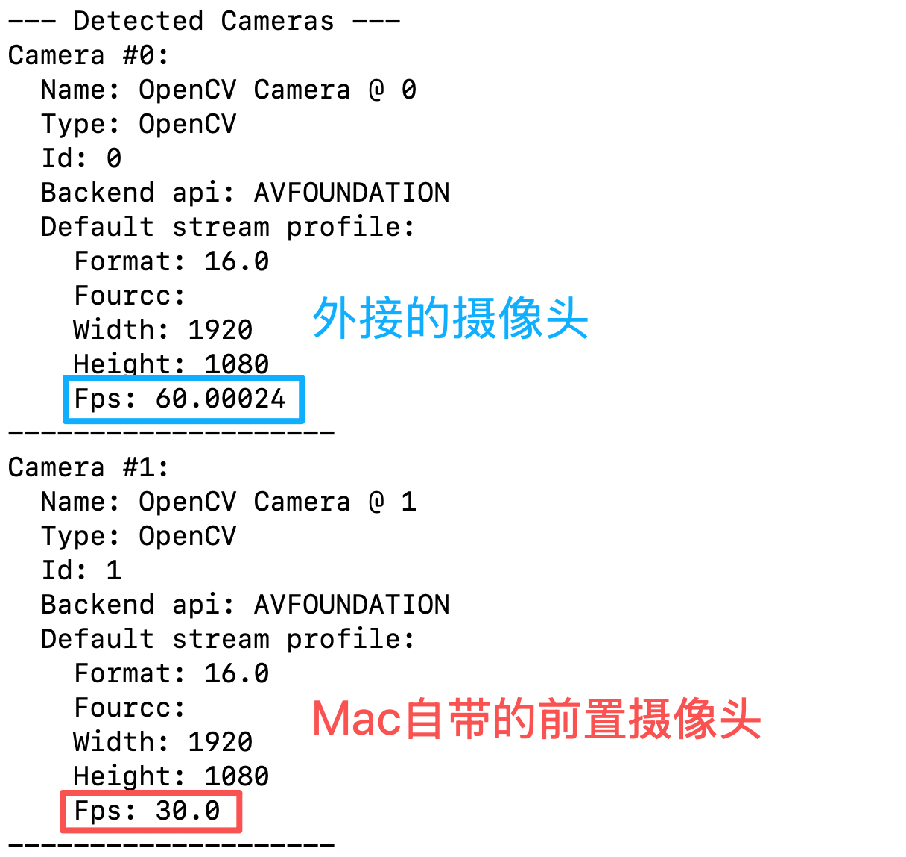

[English](../en/06-teleoperation-with-camera/mac.md) | [简体中文](../zh-hans/06-teleoperation-with-camera/mac.md) | 繁體中文 | [Deutsch](../de/06-teleoperation-with-camera/mac.md) | [Español](../es/06-teleoperation-with-camera/mac.md) | [Français](../fr/06-teleoperation-with-camera/mac.md) | [Italiano](../it/06-teleoperation-with-camera/mac.md) | [日本語](../ja/06-teleoperation-with-camera/mac.md) | [한국어](../ko/06-teleoperation-with-camera/mac.md) | [Português (BR)](../pt-br/06-teleoperation-with-camera/mac.md) | [Português (PT)](../pt-pt/06-teleoperation-with-camera/mac.md)

# Mac電腦

## 連接攝影機和電腦

```Shell
lerobot-find-cameras opencv
```



## 一個攝影機，遠端操作並顯示攝影機畫面

```Shell
lerobot-teleoperate \
    --robot.type=so101_follower \
    --robot.port=/dev/tty.usbmodem5AAF2193061 \
    --robot.id=my_follower_arm \
    --robot.cameras="{ front: {type: opencv, index_or_path: 0, width: 1920, height: 1080, fps: 60, fourcc: "MJPG"}}" \
    --teleop.type=so101_leader \
    --teleop.port=/dev/tty.usbmodem5AAF2194741 \
    --teleop.id=my_leader_arm \
    --display_data=true
```

執行後啟動遠端操作

會開啟rerun.io畫面，即時顯示各個伺服馬達關節的軌跡，以及攝影機即時畫面

並將影像儲存至`~/用户名/outputs/captured_images`目錄


## 多個攝影機，遠端操作並顯示攝影機畫面

```Shell
lerobot-teleoperate \
    --robot.type=so101_follower \
    --robot.port=/dev/tty.usbmodem5AAF2193061 \
    --robot.id=my_follower_arm \
    --robot.cameras="{ front: {type: opencv, index_or_path: 0, width: 1920, height: 1080, fps: 60, fourcc: "MJPG"}, side: {type: opencv, index_or_path: 1, width: 1920, height: 1080, fps: 30, fourcc: "MJPG"}}" \
    --teleop.type=so101_leader \
    --teleop.port=/dev/tty.usbmodem5AAF2194741 \
    --teleop.id=my_leader_arm \
    --display_data=true
```
