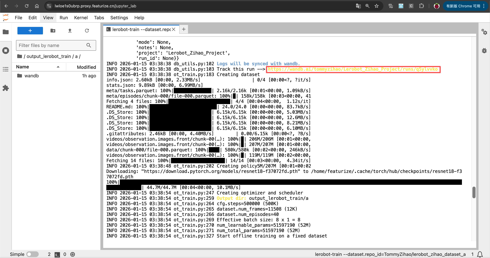
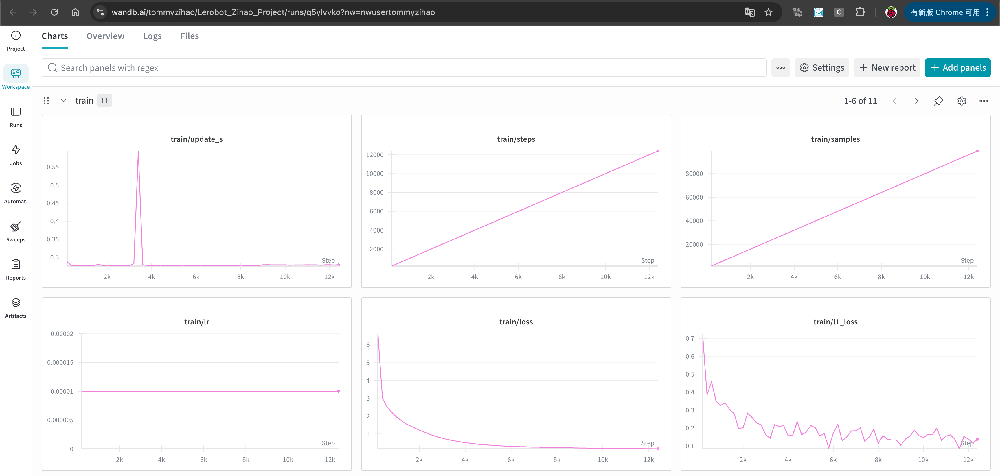

[English](../en/09-train-model/wandb-training-curves.md) | [简体中文](../zh-hans/09-train-model/wandb-training-curves.md) | 繁體中文 | [Deutsch](../de/09-train-model/wandb-training-curves.md) | [Español](../es/09-train-model/wandb-training-curves.md) | [Français](../fr/09-train-model/wandb-training-curves.md) | [Italiano](../it/09-train-model/wandb-training-curves.md) | [日本語](../ja/09-train-model/wandb-training-curves.md) | [한국어](../ko/09-train-model/wandb-training-curves.md) | [Português (BR)](../pt-br/09-train-model/wandb-training-curves.md) | [Português (PT)](../pt-pt/09-train-model/wandb-training-curves.md)

# wandb查看即時訓練曲線

- 取得wandb連結

- 查看訓練即時曲線

