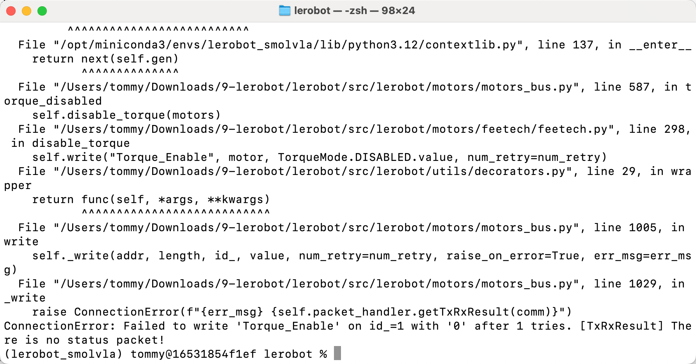

[English](../en/10-inference/common-bugs.md) | [简体中文](../zh-hans/10-inference/common-bugs.md) | 繁體中文 | [Deutsch](../de/10-inference/common-bugs.md) | [Español](../es/10-inference/common-bugs.md) | [Français](../fr/10-inference/common-bugs.md) | [Italiano](../it/10-inference/common-bugs.md) | [日本語](../ja/10-inference/common-bugs.md) | [한국어](../ko/10-inference/common-bugs.md) | [Português (BR)](../pt-br/10-inference/common-bugs.md) | [Português (PT)](../pt-pt/10-inference/common-bugs.md)

# 常見Bug及解決

## 攝影機取得失敗

檢查一下腕部攝影機的接線是否鬆動，特別是靠近攝影機那端的接線，非常容易接觸不良

## 攝影機斷連

重新啟動一下命令列

## 伺服馬達通訊問題1

ConnectionError: Failed to sync read 'Present_Position' on ids=[1, 2, 3, 4, 5, 6] after 1 tries. [TxRxResult] There is no status packet!

![這張圖片是一段終端機報錯日誌，對應文件中提及的伺服馬達通訊問題1的相關內容。日誌中顯示了具體的程式碼檔案路徑，在`lerobot/src/lerobot/motors/motors_bus.py`檔案的第1069行、第1181行，記錄了`ConnectionError: Failed to sync read 'Present_Position' on ids=\[1,2,3,4,5,6\] after 1 tries`的錯誤資訊，還標註了`There is no status packet!`的錯誤原因，完整呈現了文件中提到的伺服馬達通訊問題1的報錯詳情。](../../en/images/fix-04.png)

解決方案，把`lerobot/src/lerobot/motors/motors_bus.py`程式碼中所有`num_retry`都改成99，特別是報錯行對應的

## 伺服馬達通訊問題2

ConnectionError: Failed to write 'Torque_Enable' on id\_=1 with '0' after 6 tries. [TxRxResult] There is no status packet!

<grid>
<column width-ratio="0.500000">

</column>
<column width-ratio="0.500000">
![圖片展示的是在macOS系統下，使用zsh終端機執行命令列操作的介面。終端機顯示了多個檔案路徑及程式碼檔案內容，其中`/Users/tommy/Downloads/9-lerobot/lerobot/src/lerobot/motors/motors_bus.py`檔案中存在`ConnectionError: Failed to write 'Torque_Enable' on id_=1 with '0' after 6 tries. \[TxRxResult\] There is no status packet!`的報錯資訊。該圖片與文件中「伺服馬達通訊問題2」內容相關，直觀呈現了報錯時的終端機介面情況。](../../en/images/fix-05.png)
</column>
</grid>

解決方法：重新標定機械臂
