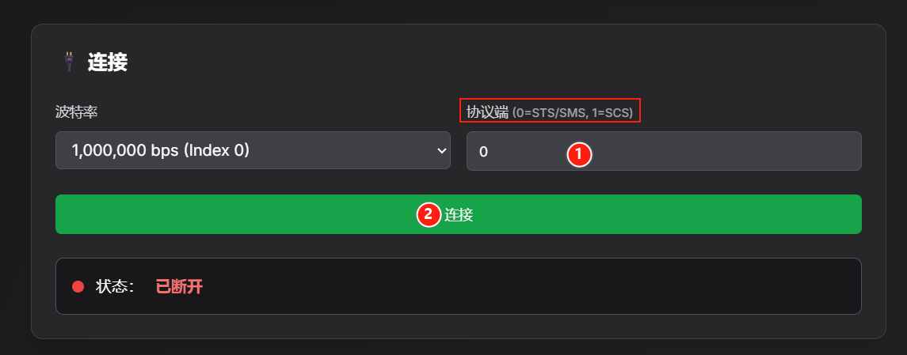
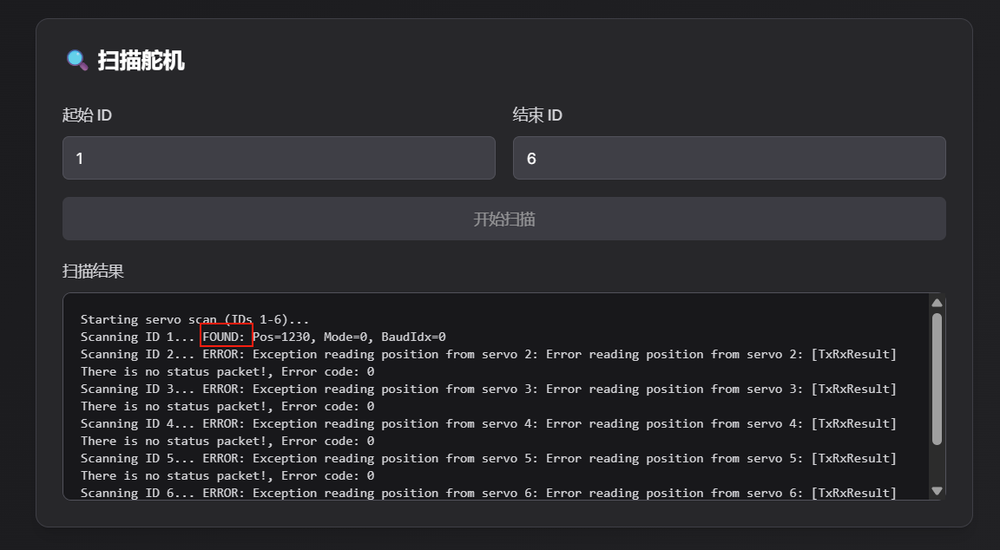
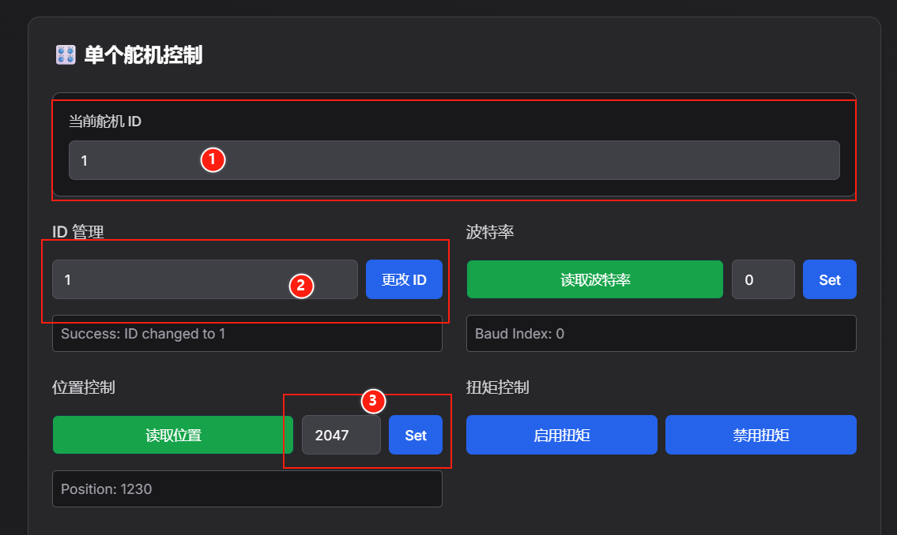

[English](../en/resources.md) | [简体中文](../zh-hans/resources.md) | 繁體中文 | [Deutsch](../de/resources.md) | [Español](../es/resources.md) | [Français](../fr/resources.md) | [Italiano](../it/resources.md) | [日本語](../ja/resources.md) | [한국어](../ko/resources.md) | [Português (BR)](../pt-br/resources.md) | [Português (PT)](../pt-pt/resources.md)

<title>一些資源</title>

# Lerbot官方的[URDF檔案](https://github.com/TheRobotStudio/SO-ARM100/blob/main/Simulation/SO101/so101_new_calib.urdf)

## URDF Studio

https://urdf.d-robotics.cc/

## ROS2 模擬控制（可自行實現）

https://github.com/holmsslk/so-arm-moveit-hardware

## LeRobot的官方圖形介面

https://github.com/huggingface/leLab

LeLab是一款網頁應用程式，它將 LeRobot 的全部工作流程——校正、遠端操作、記錄、訓練、回放——整合到一個瀏覽器介面中。只需連接機械臂，開啟應用程式，即可開始操作。無需繁瑣的命令列操作，也無需鍵盤輸入。

🤗 LeRobot 的原生網頁入口，旨在讓新使用者在幾分鐘內完成從「開箱」到「訓練他們的第一個保單」的整個過程。

🤗 只需一條命令即可安裝並執行所有程式。

# 手機控制從動臂

https://huggingface.co/docs/lerobot/main/en/phone_teleop

## 雲端機器人研發：基於 AWS 實現 ROS 2 裝置與 Isaac Sim 的 Lerobot 模擬及資料流

https://github.com/ti/ti.github.io/blob/95261efa4f8bdb4c8571920762318a532e58c7fd/%E5%BC%80%E5%8F%91/isaac/aws-ros2-isaac.md

## 網頁端設定伺服馬達ID和中位校正

https://bambot.org/feetech.js?lang=zh

1、根據伺服馬達型號輸入0或1，點擊「連接」

2、掃描ID 1\~6 的伺服馬達，可以根據掃描結果裡的FOUND確認對應ID伺服馬達。例如圖片裡伺服馬達 ID 1 被掃描到了

3、ID設定和中位校正

①目前伺服馬達ID輸入為被掃描到的伺服馬達ID

②在「ID管理」中輸入數字，點擊「更改ID」即可設定ID

③中位校正（STS3215伺服馬達中位是2047，SCS0009伺服馬達中位是511）

STS伺服馬達：在「位置控制」輸入2047，並點擊「Set」

SCS伺服馬達：在「位置控制」輸入511，並點擊「Set」

